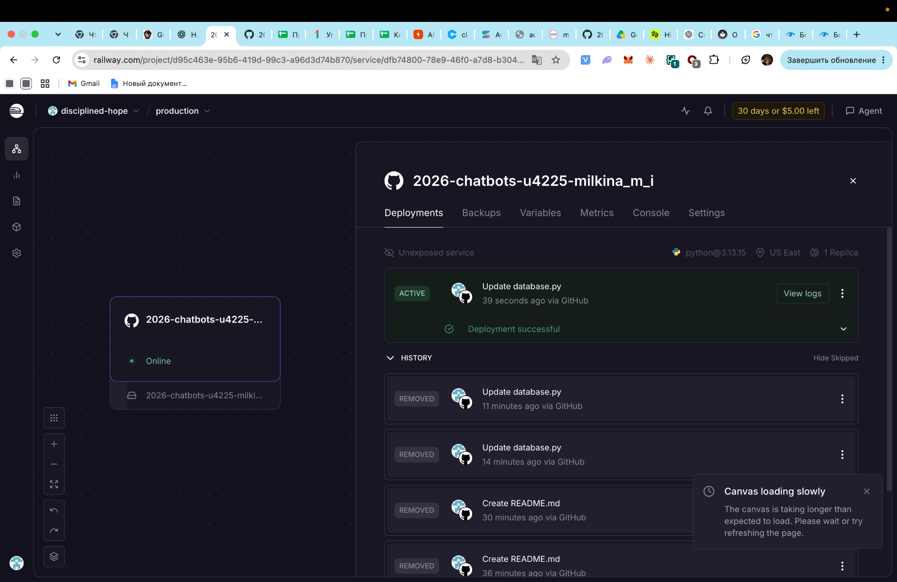
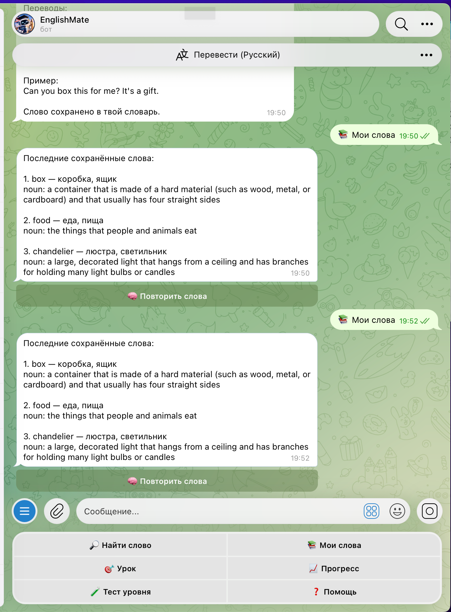
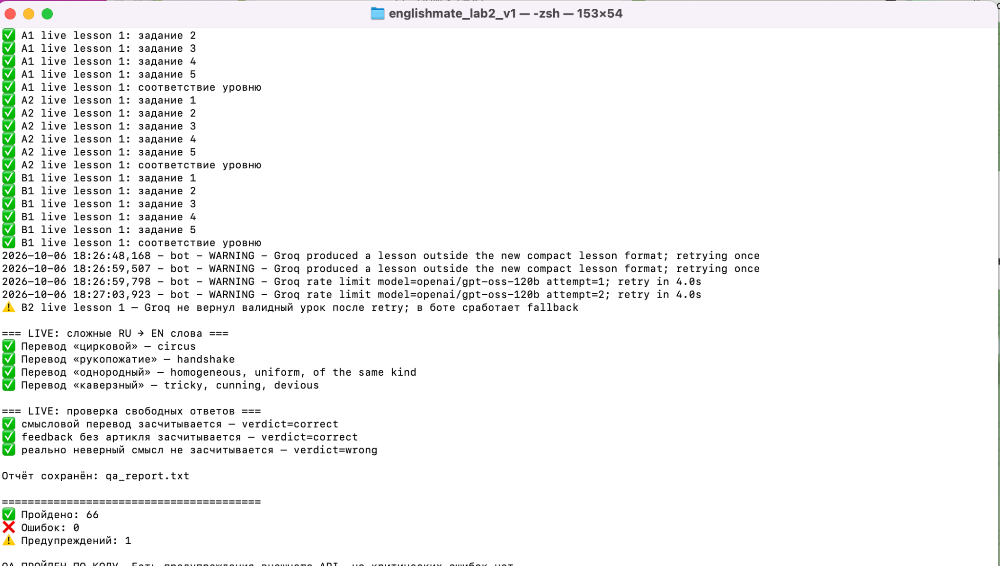
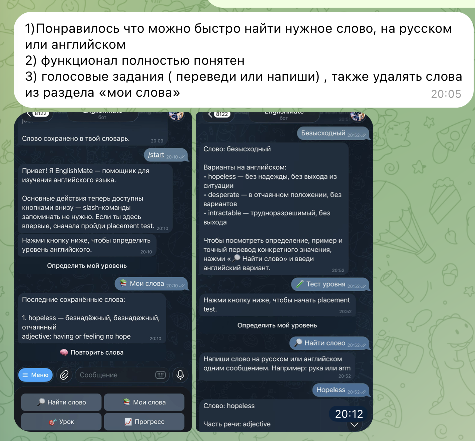
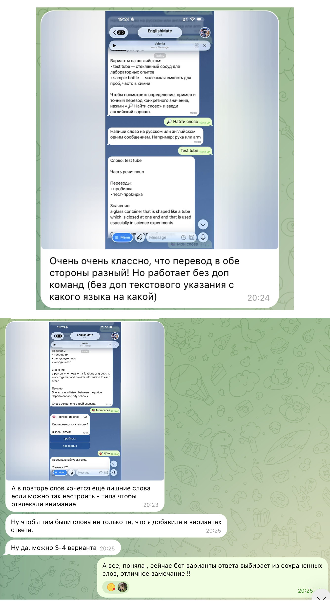
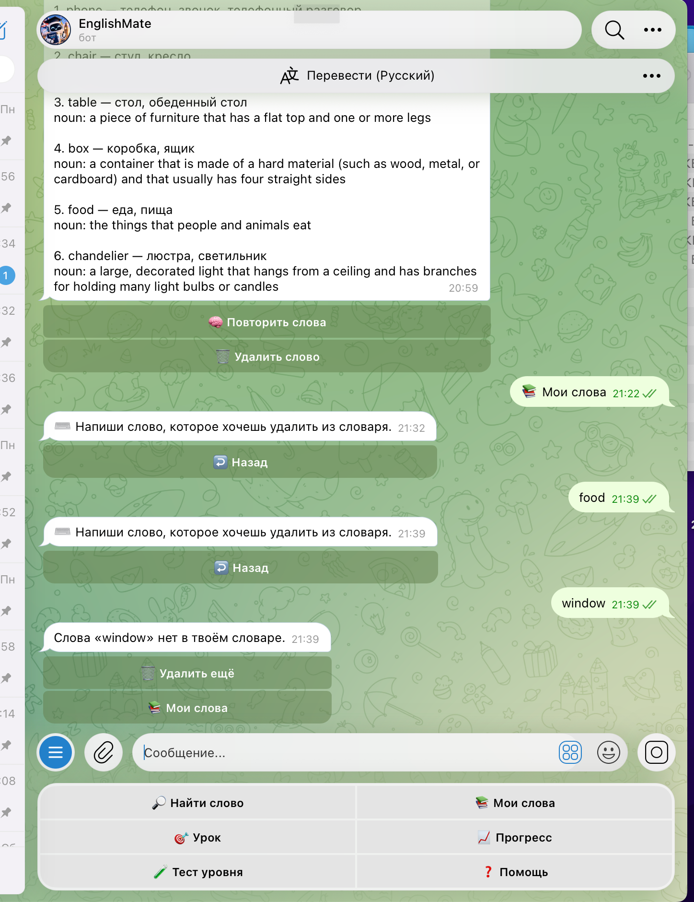
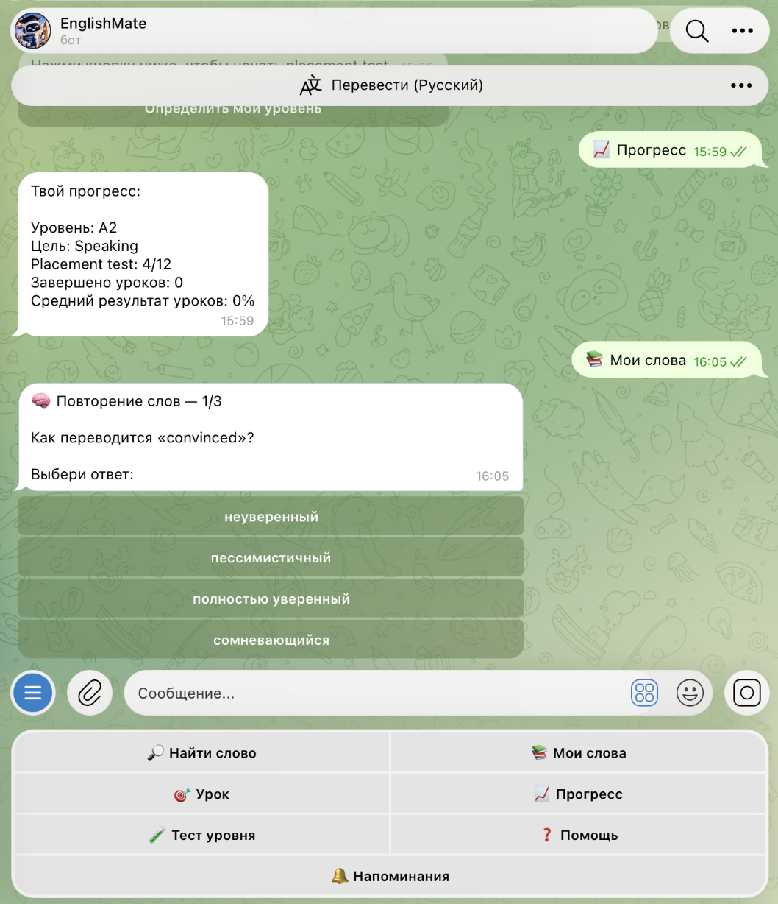
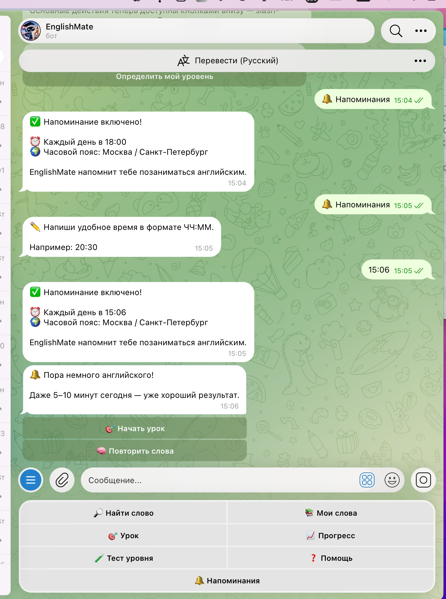
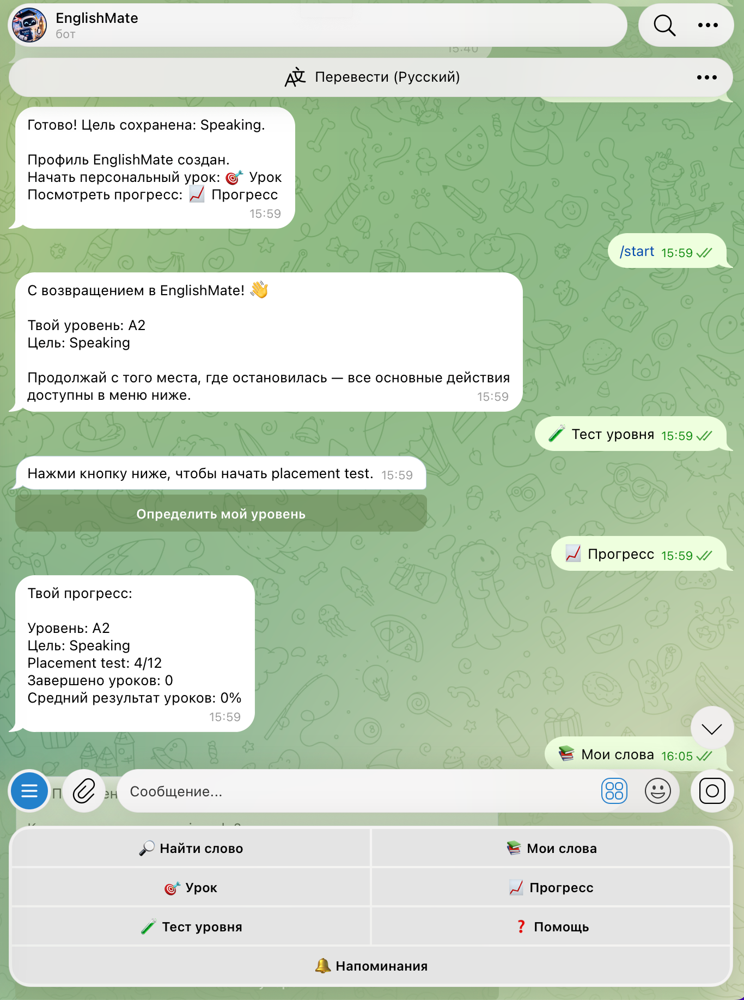

University: [ITMO University](https://itmo.ru/ru/)  
Faculty: [FICT](https://fict.itmo.ru)  
Course: Vibe Coding: AI-боты для бизнеса  
Year: 2026/2027  
Group: U4225  
Author: Maria Milkina  
Lab: Lab3  
Date of create: 06.10.2026  
Date of finished: 13.10.2026  

### 1. Описание деплоя

Для лабораторной работы бот EnglishMate был развёрнут в облачном сервисе Railway.

Бот доступен в Telegram: `@itmoftmi_mmi_bot`.

В качестве способа развёртывания был выбран Railway, потому что он позволяет подключить GitHub-репозиторий, хранить секретные переменные отдельно от кода и поддерживать постоянную работу Telegram-бота без необходимости держать локальный компьютер включённым.

Для запуска используется папка `lab3` репозитория. Бот работает через long polling.

В Railway были добавлены переменные окружения:

- `TELEGRAM_BOT_TOKEN`
- `MERRIAM_WEBSTER_API_KEY`
- `GROQ_API_KEY`

Для SQLite был подключён Railway Volume, чтобы пользовательские данные сохранялись между перезапусками и повторными deployment.

### 2. Процесс деплоя

Перед публикацией была подготовлена стабильная версия EnglishMate и проведена автоматическая проверка.

Результат QA:

- пройдено проверок: 66;
- ошибок: 0;
- предупреждений: 1.

Предупреждение было связано с временным ограничением внешнего Groq API. Для таких ситуаций в боте предусмотрен fallback, поэтому временная ошибка внешнего API не приводит к полной остановке приложения.

Основные этапы развёртывания:

1. Код Lab 3 был загружен в GitHub.
2. GitHub-репозиторий был подключён к Railway.
3. В качестве Root Directory была указана папка `/lab3`.
4. В Railway были добавлены секретные переменные окружения.
5. Для базы данных был подключён постоянный Volume.
6. После исправления ошибок запуска deployment завершился успешно.
7. Работа опубликованного бота была проверена непосредственно в Telegram.

После обновления кода в ветке `main` Railway автоматически выполняет новый deployment.

### 3. Сбор обратной связи

После развёртывания бот был передан на тестирование трём пользователям.

Пользователям было предложено проверить основные функции EnglishMate и ответить на вопросы:

1. Что понравилось?
2. Что было неудобно или непонятно?
3. Что можно улучшить?

В целом пользователи положительно оценили интерфейс и скорость работы бота.

Первый пользователь отметил удобный и структурированный интерфейс, а также скорость работы бота. По его мнению, существующего функционала уже достаточно.

Второму пользователю понравилась возможность быстро искать нужное слово как на русском, так и на английском. Интерфейс был понятен без дополнительных объяснений. В качестве улучшений пользователь предложил добавить возможность удаления слов из раздела «Мои слова», а также развивать задания с вводом собственного ответа.

Третий пользователь отдельно отметил удобство двустороннего перевода. Основным замечанием стала функция повторения слов: варианты ответа формировались из уже сохранённых слов пользователя, из-за чего некоторые задания получались слишком простыми. Было предложено использовать 3–4 более похожих и логически связанных варианта ответа.

**Отзывы пользователей:**

### 4. Анализ обратной связи

По результатам тестирования были выделены следующие основные направления улучшения:

- добавить возможность удаления ненужных слов из личного словаря;
- сделать варианты ответа при повторении слов более сложными и логически связанными;
- сохранить простой интерфейс без необходимости запоминать slash-команды;
- развивать функции, которые помогают пользователю заниматься английским регулярно.

Положительно пользователи оценили:

- понятное нижнее меню;
- поиск слов на русском и английском;
- скорость работы;
- структуру карточек слов;
- сохранение слов;
- повторение слов;
- персональные уроки.

### 5. Улучшения после обратной связи

После получения отзывов бот был доработан и повторно развёрнут на Railway.

**Удаление слов из словаря**

В разделе «Мои слова» была добавлена кнопка «Удалить слово».

Пользователь может:

- выбрать одно из последних сохранённых слов;
- ввести нужное слово вручную;
- подтвердить удаление;
- вернуться обратно к списку слов.

Возможность ручного ввода была добавлена для ситуации, когда в словаре находится большое количество слов и искать нужное слово среди большого списка кнопок неудобно.

**Улучшенное повторение слов**

Ранее неправильные варианты ответа выбирались случайным образом из других сохранённых пользователем слов. Из-за этого варианты могли относиться к совершенно разным темам, поэтому правильный ответ часто был слишком очевидным.

После обратной связи была добавлена генерация smart distractors через Groq.

Для каждого слова формируются три правдоподобных неправильных варианта:

- той же части речи;
- близкого уровня сложности;
- близкой смысловой категории;
- при этом варианты не должны быть синонимами или допустимыми переводами правильного ответа.

Таким образом, каждый вопрос содержит четыре варианта ответа: один правильный и три логически подобранных неправильных.

Если внешний AI-сервис временно недоступен, бот использует старый способ формирования вариантов как fallback.

**Ежедневные напоминания**

Дополнительно была реализована система ежедневных напоминаний о занятиях.

В основном меню появилась кнопка «🔔 Напоминания».

Пользователь может выбрать готовое время:

- 08:00;
- 10:00;
- 12:00;
- 18:00;
- 20:00;
- 21:00;

или указать собственное время вручную в формате `ЧЧ:ММ`.

После выбора времени пользователь выбирает город и часовой пояс. В текущей версии доступны:

- Москва / Санкт-Петербург;
- Рига;
- Лондон;
- Дубай;
- Бангкок;
- Ташкент.

В выбранное местное время бот автоматически отправляет сообщение-напоминание с кнопками:

- «Начать урок»;
- «Повторить слова».

Пользователь также может изменить время или полностью отключить напоминания.

Настройки сохраняются в SQLite, а автоматическая проверка времени выполняется через JobQueue.

**Сохранение профиля после `/start`**

Дополнительно была исправлена логика команды `/start`.

Ранее повторный запуск бота предлагал пользователю заново пройти placement test, из-за чего создавалось ощущение сброса прогресса.

Теперь:

- новый пользователь получает предложение пройти тест уровня;
- существующий пользователь сразу возвращается в главное меню;
- сохранённые уровень и цель отображаются после `/start`;
- повторный тест можно запустить вручную;
- при повторном прохождении теста цель пользователя больше не сбрасывается;
- сохранённые слова, уроки и другие данные остаются в профиле.

### 6. Результат

После внесения изменений бот был повторно развёрнут на Railway и протестирован.

В итоговой версии EnglishMate:

- работает в облаке независимо от локального компьютера;
- определяет уровень английского;
- сохраняет профиль пользователя;
- генерирует персональные уроки;
- проверяет ответы;
- ищет и переводит слова;
- поддерживает перевод с английского на русский и с русского на английский;
- сохраняет личный словарь;
- позволяет удалять слова;
- проводит повторение слов с более сложными вариантами ответа;
- показывает статистику прогресса;
- отправляет ежедневные персональные напоминания;
- позволяет изменить или отключить напоминания;
- сохраняет пользовательские данные между deployment.

### 7. Вывод

В ходе лабораторной работы бот EnglishMate был переведён из локального проекта в приложение, доступное реальным пользователям через Telegram.

Наиболее полезным этапом стала работа с обратной связью. После тестирования были обнаружены проблемы, которые не были очевидны на этапе первоначальной разработки: неудобство удаления слов при большом словаре и слишком простые варианты ответов при повторении.

На основе отзывов пользователей эти функции были переработаны. Дополнительно была реализована система ежедневных напоминаний, а также исправлено сохранение пользовательского профиля после повторного запуска бота.

В результате получилась более стабильная и удобная версия EnglishMate, которая работает в облаке, сохраняет пользовательские данные и может использоваться без запуска программы на локальном компьютере.
